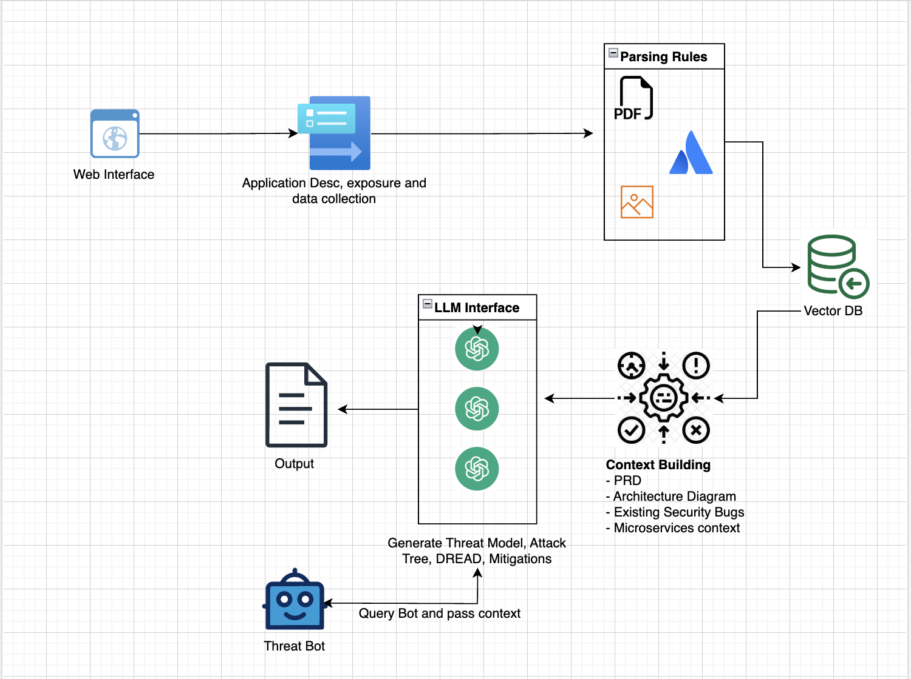

# ThreatShield

ThreatShield is an AI-powered threat modeling platform for security engineers. It automates the full security assessment workflow — from document ingestion to STRIDE threat modeling, DREAD scoring, mitigation planning, attack trees, and ASVS test case generation.

<div align="center">
  
</div>

## Features

- **Multi-source document ingestion**: Confluence, Slack threads, Google Docs, PDF uploads
- **RAG pipeline**: LangChain + Chroma vector DB extracts security-relevant context from docs
- **Six-step AI analysis**: Threat model → DREAD → Mitigations → Attack tree → ASVS test cases → Architecture diagram
- **Queue system**: Async background processing with auto-trigger on doc fetch success
- **Interactive chat**: Natural language Q&A over completed assessments
- **PDF report export**: Downloadable reports for stakeholders
- **Google OAuth login**: Secure access via Google accounts
- **Admin dashboard**: LLM config, user management, assessment retrigger, logs
- **Analytics**: Risk trends and assessment metrics
- **MCP server**: Expose ThreatShield capabilities to Claude Desktop, Claude Code, and other MCP clients
- **Jira & Slack integrations**: Ticket creation and DM notifications

## Prerequisites

- Python 3.10+
- Node.js 18+
- AWS Bedrock access **or** an OpenAI API key
- Google OAuth credentials (for login)

## Setup

### 1. Clone and configure

```bash
git clone <repo-url>
cd ThreatShield
cp .env.example .env   # edit with your values
```

### 2. Environment variables

`.env` holds **API keys and secrets only**. LLM provider/model/endpoint config lives in `settings.json` and is managed by an admin through the UI after first login.

```env
# LLM API keys — which provider to use is set in the Admin Dashboard, not here
OPENAI_API_KEY=sk-...          # required if using OpenAI
BEDROCK_API_KEY=your-key       # required if using AWS Bedrock proxy

# Google OAuth — create at https://console.cloud.google.com/apis/credentials
GOOGLE_CLIENT_ID=your-google-client-id.apps.googleusercontent.com
FLASK_SECRET_KEY=your-random-secret-key   # used to sign auth tokens

# CORS origins (comma-separated)
ALLOWED_ORIGINS=http://localhost:3000

# Confluence
CONFLUENCE_USERNAME=bot@example.com
CONFLUENCE_API_KEY=your-api-key

# Slack
SLACK_API_TOKEN=xoxb-...

# Jira
JIRA_URL=https://your-org.atlassian.net
JIRA_USERNAME=bot@example.com
JIRA_TOKEN=your-jira-token
JIRA_PROJECT=your-jira-project-key

# Google Docs service account (path to JSON file, or inline JSON)
GOOGLE_SERVICE_ACCOUNT_JSON=/path/to/service-account-key.json

# Frontend deployment (dev | stage | prod)
REACT_APP_DEPLOYMENT_TYPE=dev
REACT_APP_API_URL_DEV=http://localhost:5001/api
REACT_APP_API_URL_PROD=https://threatshield.example.com/api
```

### 3. Bootstrap settings.json

`settings.json` is created in the project root and persists admin list, LLM config, and MCP server registrations. Create it before first run:

```json
{
  "admins": ["your-email@example.com"],
  "llmConfig": {
    "method": "BEDROCK",
    "base_url": "https://your-bedrock-proxy/",
    "model": "claude-opus-4-6",
    "large_output_model": "claude-opus-4-6",
    "tested": false
  },
  "mcpServers": [],
  "darkMode": false,
  "preContext": ""
}
```

**Field reference:**

| Field | Description |
|-------|-------------|
| `admins` | Google-authenticated emails with admin access |
| `llmConfig.method` | `"BEDROCK"` or `"OPENAI"` |
| `llmConfig.base_url` | Bedrock proxy base URL (not used for OpenAI) |
| `llmConfig.model` | Model name for standard calls |
| `llmConfig.large_output_model` | Model for large-output calls; falls back to `model` if empty |
| `llmConfig.tested` | `false` initially; set to `true` after admin tests the config via the UI |
| `preContext` | Architecture context injected into every threat modeling prompt |

> **API keys are never stored in settings.json.** They always come from `.env`.

After first run, all LLM and admin config changes go through the Admin Dashboard — `settings.json` is updated automatically.

#### Adding the first admin

On first login, if no admins are configured in `settings.json`, a setup popup appears automatically. Enter your email address and click **Set as First Admin** — this calls `POST /api/setup/bootstrap-admin` and saves your email to `settings.json`. The popup only appears when the admins list is empty and disappears once an admin is set.

Alternatively, edit `settings.json` directly and add the email to the `admins` array before starting the backend.

### 4. Backend

```bash
python3 -m venv env
source env/bin/activate        # Windows: env\Scripts\activate
pip install -r requirements.txt
python3 app.py                 # runs on http://localhost:5001
```

### 5. Frontend

```bash
cd threat-shield
npm install
npm start                      # runs on http://localhost:3000
```

### 6. Full stack (one command)

```bash
./start.sh
```

This kills existing processes on ports 3000/5001/8765, loads `.env`, starts Flask, the MCP server, and the React frontend.

### 7. Docker

```bash
docker-compose up --build
```

## MCP Server

ThreatShield exposes an MCP server (`mcp_server.py`) that lets Claude Desktop, Claude Code, and other MCP clients trigger assessments and read results.

```bash
# Start (Flask backend must be running on port 5001)
python3 mcp_server.py

# Custom host/port/backend
MCP_PORT=8765 THREATSHIELD_BACKEND_URL=http://localhost:5001 python3 mcp_server.py

# Stdio mode (for Claude Desktop / Claude Code)
python3 mcp_server.py --stdio

# SSE mode
python3 mcp_server.py --sse
```

Default endpoint: `http://localhost:8765/mcp`

**Claude Desktop config** (`~/.claude/claude_desktop_config.json`):
```json
{
  "mcpServers": {
    "threatshield": {
      "url": "http://localhost:8765/mcp"
    }
  }
}
```

### MCP tools

| Tool | Description |
|------|-------------|
| `create_assessment` | Create a new assessment in the queue; accepts `methodology` from the caller |
| `get_assessment_status` | Get status and metadata for an assessment |
| `cancel_assessment` | Cancel a running or queued assessment |
| `retry_fetch_doc` | Retry a failed document fetch |
| `chat_with_assessment` | Ask a natural-language question about an assessment |
| `generate_pdf_report` | Generate and return a base64-encoded PDF report |

### MCP resources

| Resource | Description |
|----------|-------------|
| `threatshield://assessments` | List all assessments (all sources, all statuses) |
| `threatshield://assessment/{id}/details` | Assessment metadata: name, DEPARTMENT, status, timestamps |
| `threatshield://assessment/{id}/threat_model` | Full threat model |
| `threatshield://assessment/{id}/dread` | DREAD risk scores |
| `threatshield://assessment/{id}/mitigations` | Mitigation recommendations |
| `threatshield://assessment/{id}/attack_tree` | Attack tree |
| `threatshield://assessment/{id}/test_cases` | ASVS-based security test cases |

## Architecture

```
User → React frontend (port 3000)
         ↓
Flask backend (port 5001)
  ├── POST /api/queue      — create assessment, fetch docs, auto-enqueue
  ├── POST /api/upload     — direct/manual pipeline trigger
  ├── Background worker    — processes one assessment at a time
  │     └── RAG (LangChain + Chroma) → 6-step LLM pipeline
  └── Storage: storage/<assessment_id>/*.json

MCP server (port 8765) → proxies to Flask backend
```

### Request flow

1. User submits PRD details (Confluence URL, Slack thread, Google Doc, or PDF)
2. `POST /api/queue` creates the assessment, fetches documents, stores in `storage/<id>/`
3. If any document fetched successfully → auto-enqueued for background processing
4. RAG pipeline (`rag/rag_handler.py`) extracts security-relevant context
5. Six sequential LLM analyses run: threat model → DREAD → mitigations → attack tree → test cases → diagram
6. Results stored as JSON in `storage/<assessment_id>/`

### Assessment status lifecycle

```
pending → queued → processing → completed
                              ↓ (error)
                           failed
processing/queued → cancelled
```

### Storage layout

```
storage/<assessment_id>/
  details.json          — metadata: name, department, status, source, timestamps
  additionalinfo.json   — {confluenceDoc, slackThread, prdDoc} objects
  rag_result.json
  threat_model.json
  dread_assessment.json
  mitigation.json
  attack_tree.json
  test_cases.json
```

## Project structure

```
ThreatShield/
├── app.py                    # Flask app — all routes + queue worker
├── mcp_server.py             # FastMCP server
├── start.sh                  # Start all services
├── docker-compose.yml
├── requirements.txt
├── settings.json             # Admin config, LLM config, pre-context (persisted via UI)
├── core/
│   ├── threat_modeling.py    # STRIDE threat model generation
│   ├── dread.py              # DREAD risk scoring
│   ├── mitigation.py         # Mitigation recommendations
│   ├── attack_tree.py        # Attack tree generation
│   ├── asvs_test_cases.py    # ASVS-based security test cases
│   ├── generate_diagram.py   # Architecture diagram (Mermaid)
│   └── chat.py               # Conversational chat over analysis results
├── llm/
│   └── openai_module.py      # OpenAIHandler — wraps both OpenAI and Bedrock
├── rag/
│   └── rag_handler.py        # LangChain RAG with Chroma vector DB
├── utils/
│   ├── storage.py            # StorageHandler — all JSON file I/O
│   ├── confluence_handler.py # Confluence document fetching
│   ├── slack_handler.py      # Slack thread fetching + DMs
│   ├── google_docs_handler.py# Google Docs fetching via service account
│   ├── document_handler.py   # PDF processing
│   ├── pdf_generator.py      # PDF report generation
│   ├── jira.py               # Jira ticket creation
│   ├── mcp_handler.py        # MCP server config persistence
│   ├── config.py             # LLM config, connection testing
│   └── queue_handler.py      # Legacy queue handler (mostly unused)
└── threat-shield/            # React/TypeScript frontend
    └── src/
        ├── pages/            # One page per view
        ├── context/          # AssessmentContext — global state + status polling
        └── services/         # Axios API calls
```

## API reference

### Auth
| Method | Endpoint | Description |
|--------|----------|-------------|
| POST | `/api/auth/google` | Exchange Google ID token for a session token |
| GET | `/api/auth/user` | Get current authenticated user |
| POST | `/api/auth/logout` | Logout |

### Assessments
| Method | Endpoint | Description |
|--------|----------|-------------|
| POST | `/api/queue` | Create an assessment, fetch docs, auto-enqueue |
| GET | `/api/queue` | List queue items (legacy) |
| GET | `/api/storage-queue-items` | List all queue-sourced assessments |
| GET | `/api/details` | Get assessment metadata |
| POST | `/api/upload` | Trigger pipeline directly (PDF or existing assessment) |
| POST | `/api/cancel-assessment/<id>` | Cancel processing or queued assessment |
| POST | `/api/retry-fetch-doc/<id>/<doc_type>` | Retry doc fetch (prdDoc / confluenceDoc / slackThread) |
| POST | `/api/nudge-queued` | Re-enqueue stuck queued assessments |

### Analysis results
| Method | Endpoint | Description |
|--------|----------|-------------|
| GET | `/api/threat-model` | STRIDE threat model |
| GET | `/api/dread-assessment` | DREAD risk scores |
| GET | `/api/mitigations` | Mitigation recommendations |
| GET | `/api/attack-tree` | Attack tree |
| GET | `/api/asvs-test-cases` | ASVS-based security test cases |
| PUT | `/api/update-asvs-test-cases` | Update test case status |
| GET | `/api/generate-diagrams` | Architecture diagram (Mermaid) |

### Chat & reports
| Method | Endpoint | Description |
|--------|----------|-------------|
| POST | `/api/query-ai` | Chat with assessment results |
| GET | `/api/report/download-json` | Download full assessment as JSON |
| GET | `/api/report/download-pdf` | Download PDF report |
| GET | `/api/analytics-data` | Analytics and risk metrics |

### Admin
| Method | Endpoint | Description |
|--------|----------|-------------|
| GET/POST | `/api/admin/llm-config` | LLM provider configuration |
| POST | `/api/admin/test-llm` | Test current LLM configuration |
| GET | `/api/admin/feedback` | View all feedback |
| GET | `/api/admin/logs` | View processing logs |
| GET/POST | `/api/admin/admins` | Manage admin users |
| POST | `/api/admin/retrigger/<id>` | Force retrigger an assessment |

### Setup
| Method | Endpoint | Description |
|--------|----------|-------------|
| POST | `/api/setup/bootstrap-admin` | Set the first admin (only works when admins list is empty) |

### Settings & integrations
| Method | Endpoint | Description |
|--------|----------|-------------|
| GET/POST | `/api/settings` | Pre-context settings |
| POST | `/api/validate-connections` | Test Confluence/Slack connections |
| GET | `/api/connections` | Check connection status |
| GET/POST/PUT/DELETE | `/api/mcp-servers` | Manage MCP server configurations |

## LLM configuration

LLM provider, model, and endpoint are configured by an **admin** after login via the Admin Dashboard — not via `.env`. The config is stored in `settings.json` under `llmConfig`.

**API keys always come from `.env`** and are never written to `settings.json`.

| What | Where |
|------|-------|
| Provider (`BEDROCK` / `OPENAI`) | `settings.json` → set by admin via UI |
| Model name | `settings.json` → set by admin via UI |
| Bedrock proxy base URL | `settings.json` → set by admin via UI |
| `OPENAI_API_KEY` | `.env` only |
| `BEDROCK_API_KEY` | `.env` only |

Two providers are supported:

- **`BEDROCK`**: Routes through an OpenAI-compatible AWS Bedrock proxy. Default model is `claude-opus-4-6`.
- **`OPENAI`**: Uses OpenAI directly.

Both are handled by `llm/openai_module.py` (OpenAIHandler). After saving config in the Admin Dashboard, the admin must click **Test** to verify the connection — `settings.json` tracks this as `llmConfig.tested`. Assessments cannot be processed until the LLM config has been tested successfully.

## Contributing

1. Fork the repository
2. Create a feature branch (`git checkout -b feature/my-feature`)
3. Commit your changes
4. Push and open a Pull Request

## License

This project is licensed under the MIT License — see the [LICENSE](LICENSE) file for details.
